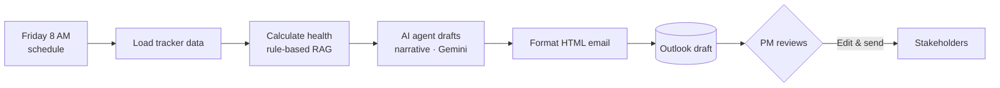

# 01 · Weekly Status Agent

> Every Friday, this agent reads the project tracker, scores project health, drafts the weekly status report, and leaves it in Outlook for the PM to review and send.

**Built with:** n8n · Google Gemini · Microsoft Outlook
**Status:** ✅ live-tested. Import [`workflow.json`](workflow.json).

---

## The problem

Weekly status reports take a PM one to two hours: pulling task data, working out what slipped, deciding the RAG colour, and writing it up for executives. The work is repetitive, and when time is short the RAG gets softened and risks get left out.

## What the agent does

1. **Trigger:** runs every Friday at 8 AM (there's also a manual trigger for testing)
2. **Gather:** loads tasks, milestones, budget and team notes from the project tracker
3. **Score:** calculates % complete, budget burn, overdue and blocked work, milestone slip, and sets **RAG with fixed rules**
4. **Draft:** Gemini writes the executive summary, accomplishments, next-week plan, risk table and decisions needed, using only the facts it's given
5. **Human check:** saves the report as an **Outlook draft**. Nothing is sent automatically.

## Architecture



## RAG rules

The same fixed rules as the agent team: see [agent-team → RAG rules](../agent-team/README.md#rag-rules).

## Guardrails

- **The AI cannot change the RAG.** Status comes from the rules above. The AI only explains it.
- **Facts only.** The prompt forbids inventing tasks, dates, names or numbers.
- **Structured output.** The AI must return a fixed JSON shape, so the email layout never breaks.
- **Nothing is sent automatically.** Reports land as drafts with a "Draft prepared by the Weekly Status Agent" banner to delete before sending, and Red reports are flagged High importance.
- **No real data.** `sample-data/` and the tracker node use a fictional project.

## Design notes

- **Rules set the RAG, not the AI.** The same data always gives the same colour, and anyone can see why. An AI judging status would drift from week to week and could soften bad news.
- **A draft, not an auto-send.** Status reports go to executives. The PM stays accountable for every word, so the agent prepares the report and the PM presses Send.
- **Structured output.** The AI must fill fixed fields (summary, done, next week, risks, decisions), so the report always has the same shape and nothing important gets skipped.

## Example output

A test run on the fictional *Project Atlas* came out **Red**: a 7-day slip on the data migration dry run, 1 critical task overdue, and 1 blocked integration.
Preview: [`sample-data/sample-output.html`](sample-data/sample-output.html)

## Setup

1. Install it with [INSTALL.md](../INSTALL.md).
2. Open the workflow and click **Execute workflow** (it starts from **Test Run** with the sample data).
3. Check your Outlook **Drafts** folder for the report.
4. To use real data, fill in your project with [`inputs/`](../inputs/README.md). **Load Project Tracker** then reads it from the `pmd_project`, `pmd_tasks` and `pmd_milestones` tables. While those are empty, it uses the fictional sample.
5. To run it every Friday at 8 AM, click **Publish** (top right).

This agent saves a **draft** and has no approval step. The full agent team in [`agent-team/`](../agent-team/) includes this same Status agent plus an approval step.

## Files

```
workflow.json                  n8n export (import this)
sample-data/sample-output.html example report from a test run (open in a browser)
```
