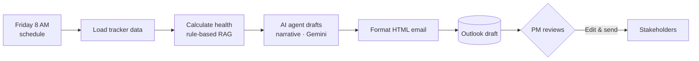

# 01 · Weekly Status Agent

> Every Friday, this agent reads the project tracker, scores project health, drafts the weekly status report, and leaves it in Outlook for the PM to review and send.

**Built with:** n8n · Google Gemini · Microsoft Outlook
**Time saved:** *to be measured over 4 weeks of real use*

---

## The problem

Weekly status reports take a PM one to two hours: pulling task data, working out what slipped, deciding the RAG colour, and writing it up for executives. The work is repetitive, and when time is short the RAG gets softened and risks get left out.

## What the agent does

1. **Trigger:** runs every Friday at 8 AM (there's also a manual trigger for testing)
2. **Gather:** loads tasks, milestones, budget and team notes from the project tracker
3. **Score:** calculates % complete, budget burn, overdue and blocked work, milestone slip, and sets **RAG with fixed rules**
4. **Draft:** Gemini writes the executive summary, accomplishments, next-week plan, risk table and decisions needed, using only the facts it's given
5. **Human check:** saves the report as an **Outlook draft**. Nothing is sent automatically.

## Architecture



## RAG rules

| Status | Rule |
|---|---|
| 🔴 **Red** | Any milestone slipped more than 5 days, **or** 2+ critical tasks overdue |
| 🟠 **Amber** | Any slip, overdue task, blocked task, or budget burn more than 10 points ahead of progress |
| 🟢 **Green** | None of the above |

## Guardrails

- **The AI cannot change the RAG.** Status comes from the rules above. The AI only explains it.
- **Facts only.** The prompt forbids inventing tasks, dates, names or numbers.
- **Structured output.** The AI must return a fixed JSON shape, so the email layout never breaks.
- **Nothing is sent automatically.** Reports land as drafts, marked "DRAFT generated by the Weekly Status Agent", and Red reports are flagged High importance.
- **No real data.** `sample-data/` and the tracker node use a fictional project.

## Design decisions

*Written in my own words. These are the questions an interviewer will ask.*

- **Why rules for RAG instead of letting the AI decide:**
- **Why an Outlook draft instead of auto-send:**
- **What I tried first that didn't work:**
- **What I'd add next:**

## Example output

A test run on the fictional *Project Atlas* came out **Red**: a 7-day slip on the data migration dry run, 1 critical task overdue, and 1 blocked integration.
Preview: [`sample-data/sample-output.html`](sample-data/sample-output.html)

## Setup

1. In n8n: **Workflows → Import from file** → `workflow.json`
2. Connect your own credentials: **Google Gemini** and **Microsoft Outlook**
3. Run **Test Run** with the sample data and check your Outlook Drafts folder
4. Replace **Load Project Tracker (Sample)** with your real source (Excel on OneDrive, Google Sheets, Jira, Asana), keeping the same field names
5. Turn the workflow on to start the Friday schedule

## Files

```
workflow.json                  n8n export (credentials removed)
workflow.sdk.ts                the same workflow as readable code
sample-data/sample-output.html example draft from a test run
docs/                          screenshots and demo
```

## Demo

*2–3 minute walkthrough video: coming soon*
