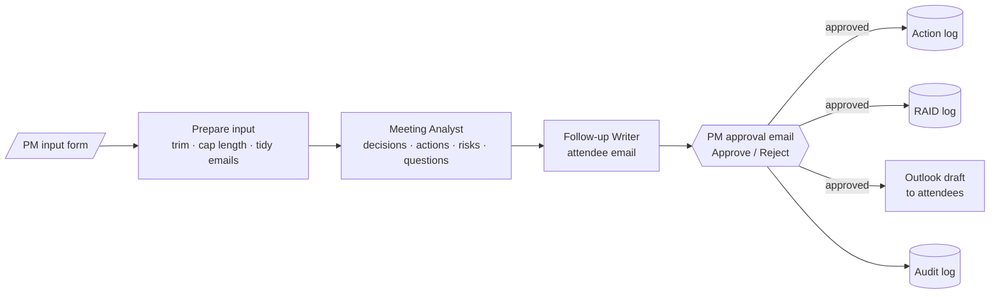

# 02 · Meeting → Actions

> Paste a meeting transcript or rough notes. The agent proposes the decisions, actions, owners, risks and follow-up email. **You approve before anything is saved.**

**Built with:** n8n · Google Gemini · Microsoft Outlook · n8n Data tables
**Status:** ✅ live-tested end to end. Import [`workflow.json`](workflow.json).

---

## The problem

After every meeting a PM rewrites the notes, works out who agreed to what, chases due dates, updates the action and RAID logs, and sends a follow-up. It's 20–30 minutes per meeting, and the "who owns this?" items are the ones that slip.

## How the PM uses it

The workflow starts with a **form**, so the PM's input is a required step:

| Field | Required | Example |
|---|---|---|
| Meeting name | ✅ | Project Atlas weekly sync |
| Meeting date | ✅ | 26 Nov 2026 |
| Attendee emails | optional | used to address the follow-up draft |
| Transcript or notes | ✅ | paste from Teams, Zoom or your own notes |

Submit, and about a minute later the approval email arrives.

## What the agent does



## Guardrails

| Guardrail | Why it matters |
|---|---|
| **No invented owners** | If nobody clearly took an action, the owner is `UNASSIGNED`. The agent never guesses who owns something. |
| **Every action quotes the meeting** | Each action shows the phrase it came from, so the PM can check it in seconds. |
| **Confidence flag** | High = explicitly agreed, Medium = implied, Low = unclear. Unassigned and low-confidence rows are highlighted in the approval email. |
| **Due dates only if stated** | "By Friday" becomes a date. Anything vaguer stays `TBD`. |
| **Nothing saved before approval** | The action log, RAID log and follow-up draft are only written after **Approve**. |
| **Audit log** | Every approve or reject is recorded with what was written. |

## Try it with the sample

`sample-data/sample-transcript.txt` is a fictional Project Atlas sync with deliberate traps:

- An action **nobody took** ("I'll find someone") should come back owned by the PM, not by an invented person.
- The **training demo** has no owner or date, so it should land in *Open questions*, not as an assigned action.
- The **sponsor** commits to two actions, which tests that owners can be senior people too.
- A **decision with a condition** (go-live holds unless the vendor misses Wednesday).

## Live test result

On the sample transcript, the agent proposed **7 actions, 2 RAID items and 3 open questions**, and they were logged after PM approval:

| Trap in the transcript | What the agent did |
|---|---|
| "I'll find someone" (PM) | Owner **Priya**, High confidence, quote attached |
| Contacts validation nobody took | Owner **UNASSIGNED**, Low confidence, **highlighted** for the PM |
| Training demo with no owner or date | Kept as **open questions**, not assigned |
| Sponsor commitments | 2 actions for **Daniel** |
| "By Friday" / "by Monday" / "I'll approve it" | Real dates where stated, **TBD** where not |
| Conditional decision | "Go-live holds unless the vendor misses Wednesday (2 Dec)" |

## Setup

1. Create the data table `pmd_action_log` with text columns: `meeting`, `meeting_date`, `action`, `owner`, `due_date`, `status`, `source`. It shares `pmd_raid_log` and `pmd_audit_log` with the main agent team.
2. Import the workflow and connect **Google Gemini** and **Microsoft Outlook**.
3. In **Settings**, set `approverEmail`. Keep `pauseSeconds` at 13 on a free Gemini key.
4. Open **PM Input Form**, copy the form URL, paste the sample transcript and submit.

## Files

```
workflow.json                    n8n export (import this)
workflow.sdk.ts                  the workflow as readable code
sample-data/sample-transcript.txt fictional meeting to test with
```
