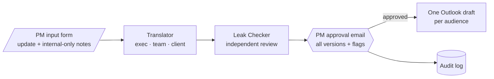

# 03 · Stakeholder Translator

> Write the update once. The agent rewrites it for executives, the team and the client. A separate reviewer then checks the client version for anything internal. **You approve before any draft is saved.**

**Built with:** n8n · Google Gemini · Microsoft Outlook
**Status:** ✅ live-tested end to end. Import [`workflow.json`](workflow.json). The test also caught and fixed a false-positive in the Leak Checker (see below).

---

## The problem

The same news goes to three audiences every week. The sponsor wants the decision, the team wants who-does-what, and the client wants reassurance plus their own actions. Rewriting it three times is slow, and the real danger is the client version: one copied line about a budget overrun or an internal dispute damages trust.

## How the PM uses it

The workflow starts with a **form**:

| Field | Required | Purpose |
|---|---|---|
| Project name | ✅ | Used in subjects and sign-off |
| The update | ✅ | Raw notes, a status report, anything |
| **Internal only** | optional | What must **never** reach the client: budget, staffing, disputes |
| Audiences | ✅ | Any of Executive, Team, Client |
| Client name | optional | Used to address the client version |
| Recipients per audience | optional | Pre-addresses each Outlook draft |

## What the agent does



| Version | Length | Framing |
|---|---|---|
| **Executive** | under 120 words | Status, business impact, the decision needed |
| **Team** | under 200 words | What changed, who does what, dates, credit for good work |
| **Client** | under 150 words | Calm and professional: what they'll see, what we're doing, what we need from them |

## Guardrails

| Guardrail | How it works |
|---|---|
| **Internal-only field** | The PM states what is confidential. The Translator may use it for exec and team, never for the client. |
| **Independent leak check** | A second AI step, with temperature 0 and a separate prompt, re-reads every version, quotes any internal information found in the client version, and flags **fact changes** in any version. |
| **Flags up front** | The approval email opens with a red or green banner, and each version shows its own flags. |
| **Drafts only** | Approved versions become Outlook **drafts**. Nothing is ever sent automatically. |
| **Audit log** | Records the decision and how many leak flags were showing when the PM approved. |

## Try it

Use the fictional inputs in [`sample-data/sample-input.md`](sample-data/sample-input.md). They include an 8% budget overrun, an overloaded team member and an invoice dispute, all marked internal only. The client version must contain none of them.

## Live test result

Run on the sample input (8% overrun, overloaded team member and invoice dispute, all marked internal only):

| Check | Result |
|---|---|
| Client version contains internal info? | ✅ **No.** Calm milestone update plus Northwind's action (confirm 6 UAT testers by 5 Dec) |
| Executive version | ✅ Status, go-live, budget impact, and an explicit decision request |
| Team version | ✅ Credits Ana, lists schedule changes and next steps |
| PM approved | ✅ 3 Outlook drafts saved, audit entry written |

**What the test caught:** the Leak Checker flagged the *executive* version for "adding facts not in the update": the budget overrun and the invoice dispute. Those facts came from the internal-only notes, which are allowed for executives, so these were false alarms. **Fix:** the checker now treats internal notes as a valid source for Executive and Team and only flags them in the Client version.

Because the PM saw the flags and their reasons before approving, the false alarm cost nothing. It's the same principle again: AI proposes, people decide.

## Setup

Install it with [INSTALL.md](../INSTALL.md) (the one-command installer or the manual import). Specific to this agent:

- To test: open the **PM Input Form** and use `sample-data/sample-input.md`.
- **Settings** box: `approverEmail` (the installer fills it in) and `pauseSeconds` (keep 13 on a free Gemini key).

## Files

```
workflow.json                 n8n export (import this)
sample-data/sample-input.md   fictional update with internal-only traps
```
