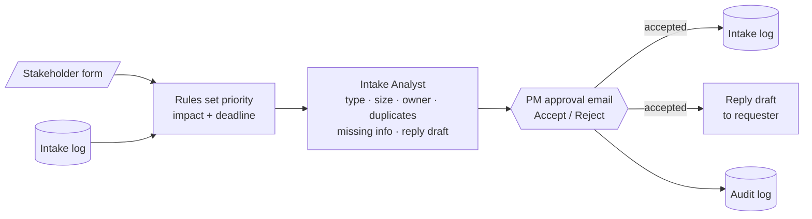

# 04 · Intake Triage

> Stakeholders submit requests through a form. Rules set the priority. The agent classifies, sizes, routes, spots duplicates and drafts the reply. **The PM accepts or rejects before anything is logged or sent.**

**Built with:** n8n · Google Gemini · Microsoft Outlook · n8n Data tables
**Status:** ✅ live-tested end to end, including the **reject** path. Import [`workflow.json`](workflow.json).

---

## The problem

Requests arrive by email, chat and hallway conversation. Half are missing information, some are duplicates, and every one needs a priority, an owner and a reply. Triage is where PMs lose hours and where requesters feel ignored.

## Input: one form for everyone

Share the form link with stakeholders. It's the only way in, so every request arrives complete:

| Field | Required |
|---|---|
| Name, email, team | ✅ name and email |
| Request title and description | ✅ |
| Business impact: *Blocks our work* · *Affects customers or revenue* · *Improvement* | ✅ |
| Needed by | optional |

## What happens



### Priority rules (not AI)

| Priority | Rule |
|---|---|
| 🔴 **P1** | Blocks work or affects customers/revenue **and** needed within 14 days |
| 🟠 **P2** | Blocks work or affects customers/revenue, **or** needed within 14 days |
| 🟢 **P3** | Everything else |

### What the Intake Analyst proposes

| Output | Detail |
|---|---|
| Type | Bug · Change request · New work · Support · Question |
| Size | S (under a day) · M (a few days) · L (1–3 weeks) · XL (needs its own project), with a reason |
| Owner | One person from **your routing table** in Settings, with a reason |
| Duplicate check | Compared against everything already in the intake log |
| Missing information | Questions the team needs answered before starting |
| Reply | A warm acknowledgement that **never promises a date** |

## Guardrails

- **Priority comes from rules,** so it's consistent and explainable to stakeholders.
- **Duplicates are flagged** in the subject line and at the top of the approval email.
- **The routing table is yours:** owners can only come from the list you set.
- **No promises:** the reply confirms the priority and that the PM will follow up, nothing more.
- **Nothing happens before the PM decides:** no log entry and no reply draft. Every decision goes in the audit log.

## Live test result

Sample: *"Show pipeline by region on the sales dashboard"* ([sample-data/sample-request.md](sample-data/sample-request.md)), approval email in **11 seconds**.

| Check | Result |
|---|---|
| Priority | ✅ **P1** (rules): revenue impact, needed in 10 days |
| Duplicate | ✅ Flagged *"Add regional sales breakdown to the pipeline dashboard"*, despite different wording |
| Type and size | ✅ Change request, **M**, with a reason |
| Owner | ✅ **A. Chen** (reporting and dashboards), with a reason |
| Missing info | ✅ Which CRM field defines a region? Restrict managers to their own region? |
| Reply | ✅ Restates the need, confirms P1, asks both questions, **no date promised** |
| PM decision | ✅ **Rejected** as a duplicate: audit entry written, **nothing** added to the intake log, **no** reply drafted |

## Setup

1. Create the data table `pmd_intake_log` with text columns: `title`, `requester`, `request_type`, `size`, `priority`, `routed_to`, `status`, `source`. It also uses the shared `pmd_audit_log`.
2. Import the workflow and connect **Google Gemini** and **Microsoft Outlook**.
3. In **Settings**, set `approverEmail` and edit `routingTable` to your team's owners.
4. Activate the workflow and share the **production** form URL with stakeholders.

## Files

```
workflow.json                   n8n export (import this)
workflow.sdk.ts                 the workflow as readable code
sample-data/sample-request.md   fictional request with a duplicate trap
```
