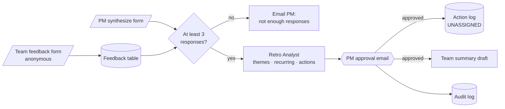

# 05 · Retro Synthesizer

> The team gives **anonymous** feedback through a form. The PM asks for a synthesis. The agent groups themes, flags recurring problems, proposes up to 3 measurable actions and drafts a team summary. **The PM approves before anything is logged.**

**Built with:** n8n · Google Gemini · Microsoft Outlook · n8n Data tables
**Status:** ✅ live-tested end to end. Import [`workflow.json`](workflow.json).

---

## The problem

Retros run out of time, the loudest voices set the agenda, and people hold back when feedback isn't anonymous. Afterwards someone has to turn sticky notes into themes and actions, and the same problems come back sprint after sprint.

## Two inputs

| Form | Who | What it collects |
|---|---|---|
| **Team Feedback Form** | Anyone on the team, anonymously | Retro name, mood 1–5, went well, to improve, ideas. **No name, no email.** |
| **PM Synthesize Form** | The PM | Which retro to synthesize, plus optional team emails for the summary draft |

## What happens



## Guardrails

| Guardrail | How it works |
|---|---|
| **Anonymous by design** | The feedback form never asks for a name or email. |
| **Minimum responses** | No synthesis below `minResponses` (default 3). With fewer, themes would identify people, so the PM gets a "not enough responses" email instead. |
| **No identifying quotes** | Quotes that point at a person, role or individual workload are paraphrased. The agent never guesses who wrote what. |
| **Recurring flag** | Problems the team says happened before are marked **↻ recurring**. |
| **Team-first actions** | At most 3, each doable in one sprint with a success measure. The team's own ideas are preferred. |
| **No AI-assigned owners** | Actions are logged as `UNASSIGNED (agree in retro)`. The team picks owners together. |
| **Approval gate + audit log** | Nothing is logged or drafted until the PM approves. |

## Live test result

6 anonymous responses for *Atlas Sprint 14* ([sample-data/sample-feedback.md](sample-data/sample-feedback.md)), average mood 3/5.

| Trap | What the agent did |
|---|---|
| Identifying quote: *"Cleanse work all sat on one person again"* | ✅ Paraphrased to *"Certain tasks sat on one person again"*, with no person or task named, and flagged **↻ recurring** |
| Two differently-worded complaints about requests | ✅ Merged into one theme, **Request Management** (2 mentions) |
| Vendor surprise mentioned twice | ✅ **Vendor Visibility** (2 mentions) |
| Team ideas vs invented actions | ✅ All 3 actions came from the team's own ideas: vendor tracker, intake form plus published priority rules, split recurring data work |
| Owners | ✅ None assigned. The summary says owners will be agreed in the retro |
| PM approved | ✅ 3 actions in the action log as `UNASSIGNED (agree in retro)`, team summary draft saved, audit entry written |

It also produced 3 open questions to start the retro meeting and an appreciative team summary with no names.

## Setup

Install it with [INSTALL.md](../INSTALL.md) (the one-command installer or the manual import). Specific to this agent:

- **Settings** box: `approverEmail` (the installer fills it in) and `minResponses` (raise it for larger teams).
- After you **Publish**, share the **Team Feedback Form** URL with the team, and keep the **PM Synthesize Form** URL for yourself.

## Files

```
workflow.json                    n8n export (import this)
sample-data/sample-feedback.md   six fictional responses with an anonymity trap
```
