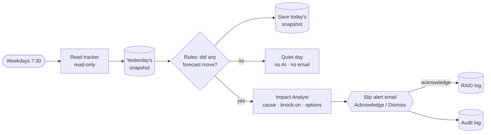

# 06 · Daily Slip Alert

> Every weekday morning, rules compare today's milestone forecasts with yesterday's. **Quiet day: no AI, no email.** If something slipped, the agent explains the cause, the knock-on risk and 2–3 options, and **the PM decides** what happens next.

**Built with:** n8n · Google Gemini · Microsoft Outlook · n8n Data tables
**Status:** ✅ live-tested: slip day and quiet day (see results below). Import [`workflow.json`](workflow.json).

---

## The problem

Schedules rarely slip in one big jump. They creep a few days at a time, and PMs find out in the weekly review, when the buffer has already gone. A daily check catches the creep, but nobody has time to read a daily report that usually says "nothing changed".

## How it works



## Guardrails

| Guardrail | Why it matters |
|---|---|
| **Rules decide when to alert** | An alert fires only when a forecast moved by at least `alertOnSlipDays` (default 1) since the last snapshot. It's predictable and explainable. |
| **Quiet days cost nothing** | No AI call, no email, no noise. The snapshot is simply refreshed. |
| **Each change alerts once** | The snapshot is saved every run, so the same slip never pages you twice. |
| **Knock-on by dependency** | Later milestones that depend on the slipped one are listed even if they haven't moved yet. |
| **AI suggests, never picks** | 2–3 recovery options, each with its trade-off. The PM chooses. |
| **Write-back after acknowledge only** | One RAID entry, and only if the PM clicks **Acknowledge**. |

## Live test result

**Slip day:** yesterday's snapshot said the dry run was due 4 Dec, and today's tracker says 8 Dec.

| Check | Result |
|---|---|
| Rules detected the slip | ✅ **+4 days** overnight (+7 vs baseline). UAT start and Go-live unchanged |
| Knock-on | ✅ **UAT start** flagged as exposed, because it depends on the dry run |
| Cause | ✅ Cited **T-102** (cleanse overdue since 23 Nov) and **T-104** (blocked on vendor credentials) |
| Buffer | ✅ 9 days between the new dry-run date and UAT start |
| Options | ✅ 2 options with trade-offs (add help on T-102, or escalate T-104). **Neither chosen by the AI** |
| RAID proposal | ✅ Issue: API integration blocked, owner R. Patel |
| Snapshot | ✅ Updated to the new forecasts |

**Quiet day:** the same data run again.

| Check | Result |
|---|---|
| Rules | ✅ `hasChanges: false`. Nothing moved since the last snapshot |
| AI call | ✅ **None** |
| Email | ✅ **None** |
| Run time | ✅ About 2 seconds |

## Setup

1. Create the data table `pmd_milestone_snapshot` with text columns: `milestone`, `forecast`, `baseline`, `captured_on`. It also uses the shared `pmd_raid_log` and `pmd_audit_log`.
2. Import the workflow and connect **Google Gemini** and **Microsoft Outlook**.
3. In **Settings**, set `approverEmail` and `alertOnSlipDays`.
4. Replace **Read Project Tracker** with your real source, keeping `name`, `baseline`, `forecast` and `dependsOn` for each milestone.
5. Run it once to create the first snapshot, then activate it. It runs Monday to Friday at 7:30.

## Files

```
workflow.json     n8n export (import this)
workflow.sdk.ts   the workflow as readable code
```
