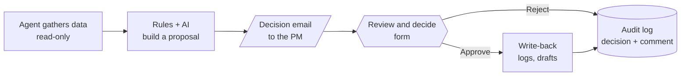
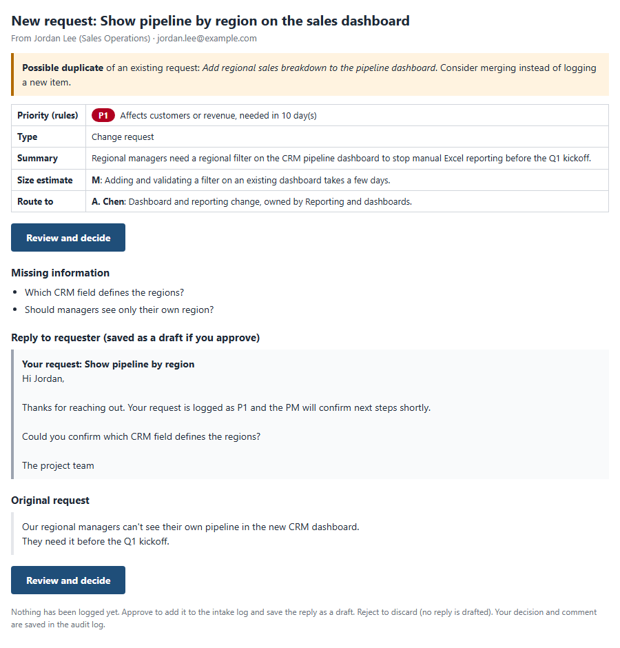

# AI Proposes. The PM Decides.

**Seven open-source AI agents for project managers, built in n8n.**
They do the weekly grunt work: status reports, meeting actions, stakeholder updates, request triage, retros, RAID and schedule checks. Then they bring the PM **one clear proposal** to approve or reject. Nothing is written to any system without the PM's OK, and every decision is logged.

> Let AI chase the updates. Let people make the decisions.

`n8n` · `Agentic AI` · `Human-in-the-loop` · `Project Management` · `PMO`

**Install:** download the zip and open the folder in **Claude Code**, then type *"install the PM agents"*. Or run `node installer/install.mjs` yourself. Step-by-step help for every setup, including the n8n free trial: **[INSTALL.md](INSTALL.md)**.

---

## Why this exists

Most "AI for PM" demos let the AI act on its own. In a real program that's a non-starter: status goes to executives, RAID logs get audited, and a wrong email to a sponsor costs trust.

These agents take the opposite approach:

- **The agents do the gathering and drafting**, which is about 80% of the effort.
- **The PM makes the call**, which is 100% of the accountability.

## The agents

| Folder | Agent | How it starts | What it proposes |
|---|---|---|---|
| [`agent-team/`](agent-team/) | **PM Agent Team** (flagship) | Every Friday, or on demand | An orchestrator briefs 4 specialists (Status, Schedule, RAID, Comms) and reviews their work into one proposal pack |
| [`01-weekly-status-agent/`](01-weekly-status-agent/) | **Weekly Status** | Every Friday | A status report saved as an Outlook draft |
| [`02-meeting-to-actions/`](02-meeting-to-actions/) | **Meeting → Actions** | The PM pastes a transcript into a form | Decisions, actions with owner, due date and supporting quote, risks, follow-up email |
| [`03-stakeholder-translator/`](03-stakeholder-translator/) | **Stakeholder Translator** | The PM pastes one update into a form | Executive, team and client versions, checked by an independent leak checker |
| [`04-intake-triage/`](04-intake-triage/) | **Intake Triage** | Anyone submits a request form | Rule-based priority, type, size, owner, duplicate check, reply draft |
| [`05-retro-synthesizer/`](05-retro-synthesizer/) | **Retro Synthesizer** | Team gives anonymous feedback, PM asks for a synthesis | Themes, recurring problems, up to 3 measurable actions, team summary |
| [`06-daily-slip-alert/`](06-daily-slip-alert/) | **Daily Slip Alert** | Every weekday at 7:30 | Only when a milestone moved: cause, knock-on risk, options, one RAID entry |
| [`00-setup/`](00-setup/) | **Setup** | The installer does it, or you click it once | Creates the 9 data tables the agents share, plus demo data |

Every agent was **live-tested end to end** on fictional data. Each folder's README shows the test results, including the bugs the tests caught and how they were fixed.

## How a decision works



1. The agent emails the PM a clear, easy-to-scan proposal (example below).
2. The PM clicks **Review and decide**. A short form opens with **Approve / Reject** and an optional **comment**.
3. Only after **Approve** does the agent write anything: log entries, or Outlook **drafts** that are never sent automatically.
4. Every decision, including rejections and "no response in time", is saved in the audit log with the PM's comment.

<p align="center"></p>

## Guardrails (all agents)

| Guardrail | How it works |
|---|---|
| **Human approval** | Nothing is written until the PM submits the decision form. No answer in time counts as a rejection. |
| **Rules where judgement must be consistent** | RAG status, request priority and slip detection come from fixed rules in code. The AI explains; it doesn't decide. |
| **No invented facts** | Every prompt limits the AI to the data it was given. Owners it can't identify are marked `UNASSIGNED`. |
| **Drafts, never auto-send** | Every email to stakeholders is saved as an Outlook draft for the PM to edit and send. |
| **Privacy** | The retro form is anonymous, the client version is leak-checked, and all sample data is fictional. |
| **Audit trail** | Every run records the proposal, the decision, the comment and what was written. |

## What you need

- A free **n8n Cloud** trial (or your own n8n), a free **Google Gemini** API key, and a **Microsoft Outlook / Hotmail** account.
- **Node.js** on your computer for the one-command installer. The manual install needs only a web browser.
- **Quick install** (paid n8n Cloud or self-hosted): about 15 minutes with the one-command installer. **Manual install** (n8n Cloud free trial): about 45 minutes. Both are in **[INSTALL.md](INSTALL.md)**.

### Free-tier friendly

Gemini's free tier allows about 5 AI requests a minute and a daily cap. The agents make **one AI call at a time** with a short pause in between (the `pauseSeconds` setting), so they stay under the limit. On a paid key, set `pauseSeconds` to 0 for faster runs.

## Repo layout

```
INSTALL.md                  the install guide (quick and manual paths)
installer/                  one-command installer (node installer/install.mjs), plus an offline self-test (node installer/selftest.mjs)
.claude/skills/             Claude Code skills: "install the PM agents", "run the PM agents on my inputs"
inputs/                     one page for your own project, a checker, and questions for your team
00-setup/                   data tables + demo data (the installer does this for you)
agent-team/                 flagship: orchestrator + 4 specialists
01-weekly-status-agent/     standalone weekly status report
02-meeting-to-actions/      transcript in, approved actions out
03-stakeholder-translator/  one update in, three audience versions out
04-intake-triage/           stakeholder requests in, triaged and routed
05-retro-synthesizer/       anonymous feedback in, themes and actions out
06-daily-slip-alert/        daily schedule check, alerts only when something moved
docs/                       example of the decision email (image + HTML)
```

Each agent folder has a `workflow.json` (the file you import into n8n), a README and sample data.

## Design notes

- **Orchestrator-workers pattern.** In the agent team, one agent plans and briefs specialists, then reviews their output for consistency. Each specialist does one focused job, which keeps prompts short and results checkable.
- **Rules for decisions that must be consistent.** RAG, priority and slip detection are deterministic, so the same data always gives the same answer and anyone can see why.
- **One proposal pack, one decision.** The PM reviews everything in one email instead of approving four separate items.
- **What the specialists wrote is what the PM approves.** RAID items and stakeholder emails pass straight through; the orchestrator can comment on them but can't rewrite them.
- **Email first.** Everyone has email, so the approval works without extra tools. Teams approvals are on the roadmap.

## Roadmap

- [x] PM Agent Team with orchestrator, 4 specialists, decision form and audit log
- [x] Six single-purpose agents (01–06) and one-click Setup
- [x] One input page for your own project, a rule-based checker, and a Claude Code skill that runs every agent from it
- [ ] Approvals in Microsoft Teams
- [ ] Connectors for Jira, Asana and Google Sheets, with write-back to the tracker
- [ ] Change-impact specialist
- [ ] PII redaction, a model router (small model for drafts, larger for analysis), and a cost and cycle-time dashboard

---

**Built by [Casper Richard Roy](https://github.com/richard-pmcollab)**, Senior Program Manager (PMP), working on agentic AI for project delivery.
If this helps your team, ⭐ the repo and tell me what you'd add.

MIT License
