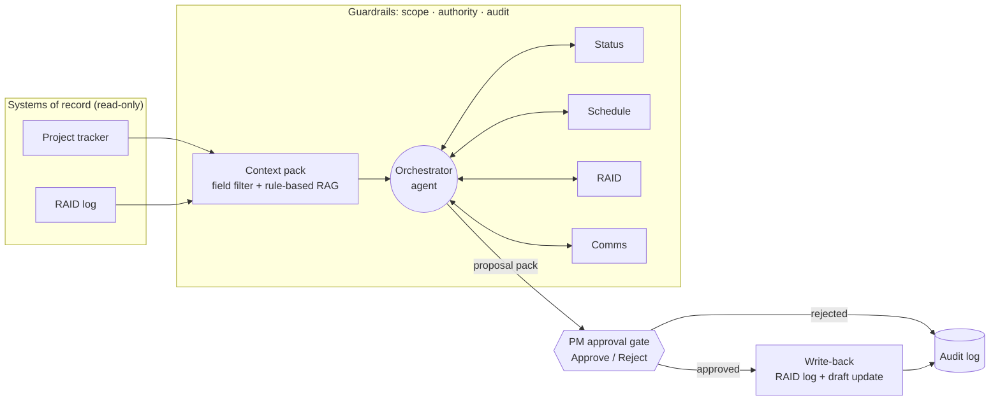

# AI Proposes. The PM Decides.

**An open-source agent team for project managers, built in n8n.**
An orchestrator agent and four specialists do the weekly grunt work: status, schedule slippage, RAID, stakeholder comms. They bring the PM **one proposal pack** to approve or reject. Nothing is written to any system without the PM's OK, and every decision is logged.

> Let AI chase the updates. Let people make the decisions.

`n8n` · `Agentic AI` · `Human-in-the-loop` · `Project Management` · `PMO`

---

## Why this exists

Most "AI for PM" demos let the AI act on its own. In a real program that's a non-starter: status goes to executives, RAID logs get audited, and a wrong email to a sponsor costs trust.

This project takes the opposite approach:

- **The agents do the gathering and drafting**, which is about 80% of the effort.
- **The PM makes the call**, which is 100% of the accountability.

## How it works



**Sense → Analyse → Propose → PM approves → Act → Log**

| Step | What happens | Who |
|---|---|---|
| **Sense** | Read tasks, milestones, budget, team notes and the RAID log | Read-only connectors |
| **Analyse** | Strip to the needed fields; calculate health; set RAG with fixed rules | Code, not AI |
| **Propose** | Orchestrator **plans** and briefs 4 specialists, they work one at a time, then the orchestrator **reviews** their output for consistency | AI agents |
| **PM approves** | PM gets an email with **Approve and apply** / **Reject** | **Human** |
| **Act** | Add new RAID items; save stakeholder update as an Outlook draft | Only after approval |
| **Log** | Record proposal, decision and what was written | Audit table |

## The specialists

| Agent | Job | Output |
|---|---|---|
| **Orchestrator** | Plans the week, briefs each specialist, then reviews their work and flags contradictions. Never writes. | Plan + proposal pack |
| **Status** | Executive summary, done this week, next week | Summary + lists |
| **Schedule** | Milestone slips, root cause, knock-on risk, one recovery action | Findings + recommendation |
| **RAID** | Finds *new* risks/issues not already in the log | Up to 4 RAID items |
| **Comms** | Sponsor update email, called last, using the others' findings | Subject + body |

## Also in this repo

| Agent | What the PM gives it | What it proposes | Status |
|---|---|---|---|
| [**02 · Meeting → Actions**](02-meeting-to-actions/) | A meeting transcript or notes, via a form | Decisions, actions with owner, due date and supporting quote, risks, open questions, follow-up email | ✅ Tested |
| [**03 · Stakeholder Translator**](03-stakeholder-translator/) | One update, internal-only notes, chosen audiences | Executive, team and client versions, checked by an independent leak checker | ✅ Tested |
| [**04 · Intake Triage**](04-intake-triage/) | Nothing: stakeholders submit via a form | Rule-based priority, type, size, owner, duplicate check, missing info, reply draft | ✅ Tested |
| [**05 · Retro Synthesizer**](05-retro-synthesizer/) | Anonymous team feedback via a form, then the PM picks the retro | Themes with counts, recurring flags, up to 3 measurable actions, team summary | ✅ Tested |
| [**Weekly Status (standalone)**](01-weekly-status-agent/) | Nothing, runs on a schedule | Weekly status report as an Outlook draft | ✅ Tested |

## Proven on a live run

Test run on the fictional *Project Atlas* (free Gemini key, about 2 minutes end to end):

- **Rules set Red:** 7-day milestone slip, 1 critical task overdue, 1 blocked.
- **Schedule specialist** noticed the dry run slipped 7 days but UAT only 2, so the buffer is being eaten.
- **RAID specialist** proposed 3 genuinely new items and suggested upgrading an existing vendor risk to an Issue, without changing it on its own.
- **PM approved** → 3 rows added to the RAID log, sponsor update saved as an Outlook draft, decision logged.

**And the reason the gate exists:** the drafted sponsor email said *"we have reassigned resources"*, but that was only a recommendation. The PM catches this before it goes out. AI proposes. People decide.

## Guardrails

| Guardrail | How it's enforced |
|---|---|
| **Read-only by default** | Connectors only read. The only writes sit behind the approval gate. |
| **Field filter** | Agents receive a trimmed context pack, not raw tracker data. |
| **AI can't change the RAG** | RAG comes from fixed rules in code. Agents are told it's final. |
| **No invented facts** | Every prompt restricts agents to the context pack. |
| **Human approval** | Email with Approve/Reject. No answer in 2 days means rejected. |
| **The PM approves exactly what the specialists wrote** | RAID items and the sponsor email pass straight from the specialists to the PM. The orchestrator's review can comment but can't rewrite them. |
| **Audit trail** | Every run logs the proposal, the decision and the write-back. |

### RAG rules

| Status | Rule |
|---|---|
| 🔴 Red | Any milestone slipped more than 5 days, or 2+ critical tasks overdue |
| 🟠 Amber | Any slip, overdue task, blocked task, or budget burn more than 10 points ahead of progress |
| 🟢 Green | None of the above |

## Quick start (about 10 minutes)

> **Status:** v1.1 passed a live end-to-end test. Import [`workflow.json`](workflow.json) and you're running in about 10 minutes.

1. **Create two data tables** in n8n (Overview → Data tables):
   - `pmd_raid_log`: `raid_type`, `title`, `impact`, `likelihood`, `owner`, `mitigation`, `status`, `source` (all text)
   - `pmd_audit_log`: `run_id`, `specialist`, `proposal`, `decision`, `decided_by`, `write_back` (all text)
2. **Import** `workflow.json` (Workflows → Import from file).
3. **Connect credentials:** Google Gemini on the 5 model nodes, Microsoft Outlook on the approval and draft nodes.
4. Open the **Settings** node: set `approverEmail` to your address. Leave `pauseSeconds` at 13 on a free Gemini key, or set it to 0 on a paid key.
5. Click **Test workflow** and keep the tab open. In about 2 minutes you'll get an approval email for the fictional *Project Atlas*.
6. Click **Approve and apply**, then check the RAID log, the audit log and your Outlook drafts. The run can take a minute or two to resume after your click.

### Free-tier mode

Gemini's free tier allows 5 requests a minute. The agents run **one at a time** with a short pause between calls, which keeps a run safely under that limit. It's slower (about 2 minutes) but costs nothing.

To use real data, replace **Read Project Tracker** with Jira, Asana, Monday.com, Excel or Google Sheets, keeping the same field names.

## Roadmap

- [x] **v1:** orchestrator, 4 specialists, email approval gate, write-back, audit log
- [x] **v1.1:** free-tier mode (paced calls), orchestrator plan + review, Settings node, live-tested
- [x] **02 Meeting → Actions:** PM input form, evidence-backed actions, approval gate, live-tested
- [x] **03 Stakeholder Translator:** exec / team / client versions + independent leak checker, live-tested
- [x] **04 Intake Triage:** stakeholder form, rule-based priority, duplicate detection, live-tested (incl. reject path)
- [x] **05 Retro Synthesizer:** anonymous feedback, minimum-responses rule, recurring-issue flags, live-tested
- [ ] Daily Slip Alert
- [ ] **v2:** Change-impact specialist · Teams approval · write-back to the tracker · Google Sheets connector
- [ ] **v3:** PII redaction · model router (small model for drafts, large for analysis) · cost and cycle-time dashboard · Jira and Asana connectors

## Repo contents

```
workflow.json        n8n export (import this)
workflow.sdk.ts      the same workflow as readable code
docs/                screenshots, demo, design notes
01-weekly-status-agent/   standalone version of the Status specialist
02-meeting-to-actions/    transcript in, approved actions out
03-stakeholder-translator/ one update in, three audience versions out
04-intake-triage/          stakeholder requests in, triaged and routed
05-retro-synthesizer/      anonymous feedback in, themes and actions out
```

## Design notes

Built on the **orchestrator-workers** agent pattern: one agent plans and delegates, and specialists do focused work. It adds a mandatory human gate before any action. The design choices are mine, and so is everything in **Design decisions** below.

### Design decisions

*In my own words:*

- **Why the AI doesn't set the RAG:**
- **Why one proposal pack instead of four separate approvals:**
- **Why email approval first, not Teams:**
- **What I'd change for a 50-project PMO:**

---

**Built by [Casper Richard Roy](https://github.com/richard-pmcollab)**, Senior Program Manager (PMP), working on agentic AI for project delivery.
If this helps your team, ⭐ the repo and tell me what you'd add.

MIT License
