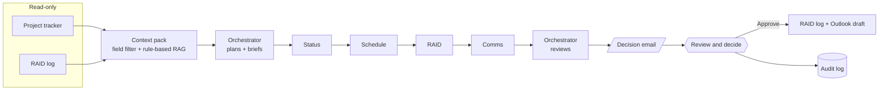

# PM Agent Team (flagship)

> An orchestrator agent plans the week and briefs four specialists: Status, Schedule, RAID and Comms. It reviews their work and sends the PM **one proposal pack** to approve or reject.

**Built with:** n8n · Google Gemini · Microsoft Outlook · n8n Data tables
**Status:** ✅ live-tested end to end. Import [`workflow.json`](workflow.json).

---

## How it works



| Step | What happens | Who |
|---|---|---|
| **Sense** | Read tasks, milestones, budget, team notes and the RAID log | Read-only connectors |
| **Analyse** | Keep only the fields the agents need; set RAG with fixed rules | Code, not AI |
| **Propose** | The orchestrator plans and briefs 4 specialists, who work one at a time; the orchestrator then reviews their output for consistency | AI agents |
| **PM decides** | Decision email, then a form with Approve / Reject and an optional comment | **Human** |
| **Act** | Add new RAID items; save the sponsor update as an Outlook draft | Only after Approve |
| **Log** | Proposal, decision, comment and what was written | Audit table |

## The specialists

| Agent | Job | Output |
|---|---|---|
| **Orchestrator** | Plans the week, briefs each specialist, then reviews their work and flags contradictions. Never writes. | Plan + proposal pack |
| **Status** | Executive summary, done this week, next week | Summary + lists |
| **Schedule** | Milestone slips, root cause, knock-on risk, one recovery action | Findings + recommendation |
| **RAID** | Finds *new* risks and issues not already in the log | Up to 4 RAID items |
| **Comms** | Sponsor update email, written last from the others' findings | Subject + body |

## RAG rules

| Status | Rule |
|---|---|
| 🔴 **Red** | Any milestone slipped more than 5 days, **or** 2+ critical tasks overdue |
| 🟠 **Amber** | Any slip, overdue task, blocked task, or budget burn more than 10 points ahead of progress |
| 🟢 **Green** | None of the above |

## Live test result

Fictional *Project Atlas*, free Gemini key, about 2 minutes end to end:

- **Rules set Red:** 7-day milestone slip, 1 critical task overdue, 1 blocked.
- **Schedule specialist** noticed the dry run slipped 7 days but UAT only 2, so the buffer is being eaten.
- **RAID specialist** proposed 3 genuinely new items and suggested upgrading an existing vendor risk to an Issue, without changing it itself.
- **PM approved:** 3 rows added to the RAID log, sponsor update saved as an Outlook draft, decision logged.

**Why the approval step exists:** the drafted sponsor email said *"we have reassigned resources"*, but that was only a recommendation. The PM catches it before anything goes out.

## Setup

Install it with [INSTALL.md](../INSTALL.md). Specific to this agent:

- **Settings** box: `approverEmail` (the installer fills it in) and `pauseSeconds` (keep 13 on a free Gemini key; 0 on a paid key).
- To test, click **Execute workflow**. The decision email arrives in about 2 minutes.
- To use real data, fill in your project with [`inputs/`](../inputs/README.md). **Read Project Tracker** then reads it from the `pmd_project`, `pmd_tasks` and `pmd_milestones` tables. While those are empty, it uses the fictional sample. **Publish** it to run every Friday at 8 AM.

## Files

```
workflow.json   n8n export (import this)
```
